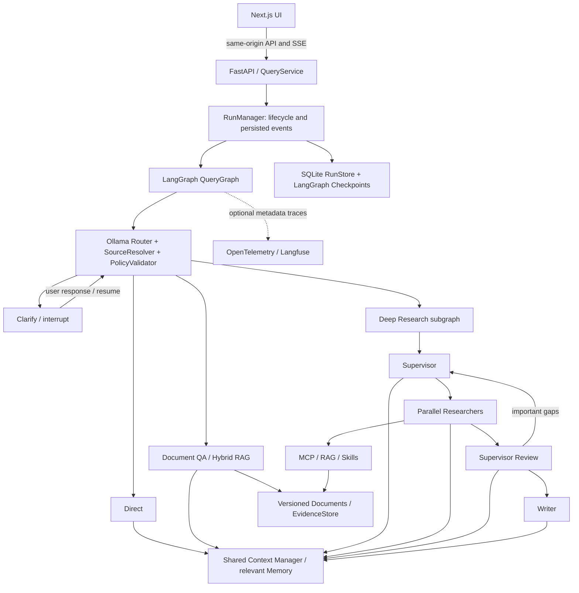

# Sage Scholar

**An Evidence-Grounded Research Agent**

A personal research workspace for paper Q&A, multi-agent deep research, and reusable research memory. Answers and reports retain links to versioned source evidence; long-running work can be stopped, inspected, and resumed.

## Demo

Screenshots and a recorded walkthrough are not yet included. Run the app locally to try document Q&A, research progress, source inspection, and conversation history. No generated product screenshots or synthetic success rates are presented here.

## Core features

- **LangGraph workflows:** a local semantic Router selects Direct, document QA, clarification, or a Deep Research subgraph. Code enforces document scope and web permissions.
- **Multi-agent research:** Supervisor → parallel Researchers → Supervisor Review → Writer. Researchers produce Markdown notes; the Writer produces one complete report.
- **Hybrid and multimodal retrieval:** SQLite FTS5/BM25 + FAISS → RRF → configurable reranking. Optional PDF page/figure retrieval uses a separate visual embedding index and a vision-capable reading model.
- **MCP + Skills:** capability-scoped MCP tools and lazily loaded `paper-review` / `citation-check` instructions. Citation checking is on demand, not a mandatory research stage.
- **Memory and context:** scoped long-term memory, semantic recall, token budgets, history compression, externalized tool results, and original-evidence rereading. Memory is not citation evidence.
- **Durable interaction:** persisted conversations, Run events, cancellation, checkpoints, continuation, and recoverable human-in-the-loop clarification.
- **Agent observability:** optional OpenTelemetry traces exported to Langfuse, with model/tool timings, token usage and configured cost estimates. Content export is disabled.

## Architecture



A single backend process owns Runs and MCP lifecycles. SQLite is the source of truth; Langfuse is an optional observer. This is a personal modular monolith, not a distributed or authenticated multi-tenant service.

## Tech stack

| Layer | Implementation |
|---|---|
| Backend | Python, FastAPI, Uvicorn |
| Agent execution | LangGraph; LangChain Core message primitives; custom LLM/tool adapters |
| Frontend | Next.js 16, React 19, TypeScript, SSE |
| Models | Ollama `qwen3.5:2b` Router; configurable answering providers |
| Retrieval | SQLite FTS5/BM25, FAISS, RRF, Sentence Transformers / CrossEncoder |
| PDF | pdfmux, PyMuPDF; optional Docling and Qwen3-VL embedding |
| Storage | SQLite, versioned files, JSON memory/catalog records |
| Observability | OpenTelemetry → Langfuse (opt-in) |
| Deployment | Docker Compose; standalone Next.js + single-process FastAPI |

## Quick start

Requirements: a running Docker Engine with Compose, a reachable Ollama with `qwen3.5:2b`, and credentials for your answering model. Web research additionally needs suitable network/tool access. Large model weights are **not** included in the images.

```bash
cp .env.docker.example .env.docker
# Edit .env.docker: answering-model credentials and ROUTER_BASE_URL.
# See the deployment guide for connecting your existing host Ollama.

docker compose build
# Explicit preparation, once per model/cache. May download several GB.
docker compose run --rm --no-deps backend python -m deploy.prepare_models

docker compose up -d --build
```

Open **http://localhost:3000**. After configuration and model preparation, the last command starts both services. The backend is internal to the Compose network; the browser uses Next.js `/api`, including streamed responses.

```bash
docker compose ps
docker compose logs -f backend frontend
curl -f http://localhost:3000/api/health
docker compose down  # Keeps named data/model volumes; do not add -v to retain data.
```

[Docker deployment](docs/deployment/docker.md) covers the optional Ollama profile, model-cache reuse, visual dependencies, proxy settings, backups and verification. For local development, the existing `./setup.sh` is unchanged: [local setup](docs/local-development.md).

## Evaluation

Recorded results, not a claim of independent generalization:

| Evaluation | Conditions | Recorded result |
|---|---|---|
| Router regression, 2026-11-04 | 144 behavior cases, local Qwen3.5:2b, macOS ARM64; candidate labels used during prompt refinement | Accuracy **90.28%**; Clarify precision **73.68%**, recall **82.35%**, F1 **77.78%** |
| Reranker baseline, 2026-10-23 | 14 source-checked passage questions (7 Chinese / 7 English), identical candidates, CPU; MiniLM-L-6-v2 | Recall@3 **0.857**, MRR **0.810**, nDCG **0.821** |

The Router set is a **development/regression set**, with remaining QA/Research confusions. The reranker snapshot did not load BGE successfully; BGE is now the configurable default, but that snapshot does **not** establish its superiority. These results do not measure end-to-end research factual accuracy.

See [Router results and conditions](docs/router-evaluation.md), [reranker report](evals/reports/reranker-20261023-111606.md), and the [Eval runner and quality gates](evals/README.md). Mock, live-model and historical-Run evaluations are separated; default CI does not make paid LLM calls.

## Documentation

- [Deployment and persistence](docs/deployment/docker.md) · [Local development](docs/local-development.md)
- [Configuration](docs/configuration.md) · [Architecture](docs/architecture.md)
- [RAG and PDF retrieval](docs/rag.md) · [Deep Research](docs/deep-research.md)
- [Router evaluation](docs/router-evaluation.md) · [Observability](docs/observability.md)
- [Troubleshooting](docs/faq.md) · [Historical implementation notes](docs/implementation-notes.md)

## Acknowledgements and licensing

Built from reusable components of [SAGE Research](https://github.com/qinyu8028/sage-research), with design references including [Yuxi](https://github.com/xerrors/Yuxi), [deepresearch-agent](https://github.com/qiqihezh/deepresearch-agent), and [Hermes Agent](https://github.com/NousResearch/hermes-agent). See the [migration map](docs/migration-map.md) for source attribution.

A project-wide LICENSE has not yet been added to this repository. Upstream code, dependencies and model weights retain their respective license requirements; this README does not grant a new license.
