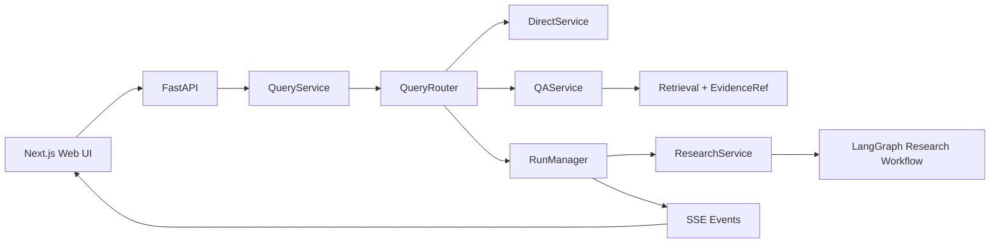

# SAGE Scholar

SAGE Scholar 是基于 SAGE Research 重构的单进程科研 Agent 应用。当前版本已打通第一条完整链路：统一查询接口先经过 Router，再按任务复杂度执行 Direct、文档 QA 或异步 Deep Research。FastAPI 只处理协议，业务编排集中在 `QueryService`，长任务生命周期由 `RunManager` 管理，研究 Graph 只维护 workflow 内部状态。



## V3：Deep Research Evidence 化（2026-09-26）

- 研究员保留 ReAct 工具循环，输出结构化 ResearchNote、真实 evidence_ids、unknowns 和 conflicts。
- 原 LangGraph 增加任务依赖/定向补查、Gap Review、Claim/Evidence 核验和有限 Writer 修订。
- 搜索摘要、状态和错误仅作为 Observation；明确读取的原文进入 EvidenceStore，报告仍不自动入库。
- 只将通过来源身份及语义支持核验的 Claim 纳入正文；最终引用由确定性 renderer 编号，Run result 返回 citations → Evidence API 映射。
- 缺口、预算耗尽或未支持主张产生 PARTIAL；SSE/前端增加撰写、核验、修订阶段。Direct/QA/文档版本与原 HTTP 路径保持兼容。
- 验证：101 项后端测试通过；compileall、前端 lint/build、diff 检查通过。外部 LLM/MCP 使用测试替身，真实语义质量未评测。
- 详细实现、预算参数、测试范围和技术债见 [V3 交付说明](docs/v3-research-evidence.md)。文档按既有 .gitignore 仅保留本地。

## V2.1 修补（2026-09-26）

- 文档身份与内容版本分离：稳定来源或显式 document_id 更新原 Document，版本成功后切换 active_version。
- 摄取锁与目录锁分开，GET /api/library 能观察 parsing/indexing；新版 failed 时旧 active version 仍可检索。
- 同内容及解析器版本不变时不增加版本；历史 Evidence 继续绑定旧版。上传新版需传 document_id，不按文件名猜测合并。
- 59 项后端测试、compileall、前端 lint/build 通过。行为、API 示例及已知边界见 [V2.1 修补说明](docs/v2.1-document-version-patch.md)。

## 上轮更新（2026-09-25）

- ExecutionRequest 将 Router 的资料范围、文档 ID 和联网限制传到 QA/Research；工具层强制执行。
- 文档使用持久 UUID、内容版本和摄取状态；Evidence 保存原文、版本、位置并支持 API 回读。
- QA 区分定点检索和全文章节概览，内部使用 evidence ID，检测无效引用编号。
- Research 保留原图，新增 PARTIAL 结果与缺口展示；原 HTTP URL 保持不变。
- 最终验证：43 项后端测试、compileall、前端 lint/build 全部通过。真实外部模型/MCP 连通性未在本轮测试。
- 完整交付及边界见 [本轮交付说明](docs/iteration-source-policy.md)。文档按 .gitignore 保留在本地。

## 当前可以运行的功能

- `Direct`：日期、星期等本地确定性问题不调用模型；其他简单问题通过统一 Model Gateway 回答。
- 连续对话：回答后保留输入框和本轮消息，最近 20 条用户/助手消息会作为 Direct 追问上下文；点击“新对话”可清空本轮上下文。
- `QA`：从上传的论文/文档进行 BM25 + 向量检索、RRF、rerank，并以结构化 `EvidenceRef` 返回证据。
- `Deep Research`：复用 SAGE Research 的 LangGraph 与并行 ReAct，现为 contract → task DAG → ResearchNote → gap review/targeted retry → Claim → citation verification/revision → renderer，由后台 `Run` 执行并通过 SSE 推送进度。
- 研究报告只作为 Run 产物返回，不会自动写回 RAG；仅在用户主动点击保存时进入文档库。
- 文档库：上传、导入、列表、删除、保存研究报告。
- 长任务：创建、查询状态、取消、SSE 事件回放；当前状态保存在单进程内存中。
- 自适应路由：`今天是星期几` 走 Direct，`帮我调研 AI4CFD 领域的主要方法` 走 Deep Research；指代论文但未选择文档时返回澄清提示。

Router 已为 `Search`、`Citation Audit` 和 `Paper2Code` 建立稳定枚举与返回协议，但这三条执行链尚未接入，调用时会明确返回 `not_implemented`，不会伪造结果。

## 目录

```text
sage-scholar/
├── sage_scholar/
│   ├── api/              # HTTP、schema、SSE
│   ├── application/      # Query/Direct/QA/Research/Document services
│   ├── routing/          # workflow 与 source policy 判断
│   ├── runtime/          # Run 生命周期、取消、事件回放
│   ├── domain/           # Evidence 等共享领域模型
│   ├── infrastructure/   # 依赖组装与旧实现 adapter
│   ├── research/         # Deep Research runtime
│   ├── graph/            # LangGraph workflow
│   ├── rag/              # hybrid retrieval
│   ├── context/          # 现有 history compaction
│   ├── tools/            # 统一工具基础接口与 registry
│   ├── library/          # 文档转换和文档库
│   ├── mcp/              # MCP client/adapter
│   └── agents/           # research agents 与 prompts
├── web/                   # Next.js 前端
├── tests/                 # Router、QueryService、API 测试
├── configs/               # Agent/MCP 配置
├── data/                  # 本地文档和索引
└── docs/                  # 审计与迁移记录
```

## 环境要求

- Python `3.11–3.14`，推荐 `3.12`
- Node.js `24.21.0`；仓库提供 `.nvmrc`，与你当前终端版本一致
- npm

macOS 推荐使用 CPU/MPS 版 PyTorch，不要安装 CUDA wheel：

```bash
cd /Users/pan/Desktop/1/sage-scholar
conda create -n sage-scholar python=3.12 -y
conda activate sage-scholar
python -m pip install -r requirements.txt

nvm install
nvm use
npm_config_cache="$PWD/.npm-cache" npm --prefix web install

cp .env.example .env
```

`.env` 按实际使用的能力填写：

- 普通 Direct 和 Deep Research 需要所选 LLM provider 的 key。
- 文档 QA/入库的向量能力需要 Embedding 配置。
- Brave、Tavily、GitHub 和其他 MCP 服务都是可选项；未配置的服务会被跳过。
- `/api/health`、日期/星期 Direct 和 Router 测试不需要任何 key。

## 启动

分别启动后端和前端：

```bash
cd /Users/pan/Desktop/1/sage-scholar
conda activate sage-scholar
python server.py
```

```bash
cd /Users/pan/Desktop/1/sage-scholar
nvm use
npm --prefix web run dev
```

访问 `http://localhost:3000`，后端默认地址为 `http://localhost:8000`。也可以在完成 `.env` 配置后运行 `./setup.sh` 同时启动两端；按 `Ctrl+C` 会通过脚本 trap 结束两个进程。

统一查询接口示例：

```bash
curl -X POST http://localhost:8000/api/queries \
  -H 'Content-Type: application/json' \
  -d '{"query":"今天是星期几","timezone":"Asia/Shanghai"}'
```

## 验证

```bash
cd /Users/pan/Desktop/1/sage-scholar
python -m pytest -q
python -m compileall -q sage_scholar tests
npm --prefix web run lint
npm --prefix web run build
```

## 已知边界

- `RunManager` 当前只提供进程内状态和事件回放；服务重启后不能 resume。
- Deep Research 已接入 Note/Claim/Evidence 与引用核验；尚无持久化 checkpoint、完整审计 lineage 和全量 Context Manager。语义核验依赖模型判断，仍需真实样本检验。
- PDF 证据目前可以带来源、版本和可选 section/page 字段，但旧解析链不能稳定提供逐页定位。
- Search、Citation Audit、Paper2Code、完整 Eval、Trace/监控和代码沙箱仍待实现。
- 本阶段没有引入 Redis、Celery、Kafka、独立 Worker、认证或多用户并发体系。

工程审计见 [`docs/repository-audit.md`](docs/repository-audit.md)，逐文件迁移来源见 [`docs/migration-map.md`](docs/migration-map.md)。
