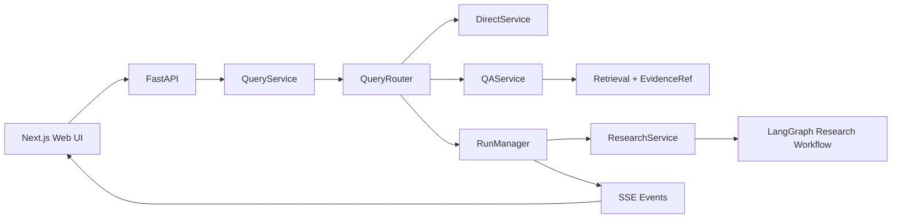

# SAGE Scholar

SAGE Scholar 是基于 SAGE Research 重构的单进程科研 Agent 应用。当前 V4.2 已支持 Direct、文档 QA、异步 Deep Research 与 Citation Audit，并统一上下文预算、显式 Memory 和可恢复 Run。统一查询接口先经过 Router，再按任务复杂度选择执行链。FastAPI 只处理协议，业务编排集中在 `QueryService`，长任务生命周期由 `RunManager` 管理，研究 Graph 只维护 workflow 内部状态。



## V4.2：统一 Context 与 QA 连续追问（2026-10-02）

- Context 采用当前指令/SourcePolicy/明确限制 + 最近两轮原始对话 + 较早历史结构化摘要 + Memory + 任务笔记/证据；不再把全部历史 user message 复制进 system。当前指令优先于旧限制与 Memory。
- 旧历史按 token 分块，用同一个 LLMClient 增量汇总目标、先前结论、未解决问题和指代；摘要不作为科研事实。`data/context_summaries` 原子保存摘要，原对话保存在 `data/context_artifacts`，同一 Run 恢复时按内容指纹复用，不展开旧历史到 prompt。压缩失败明确降级为不完整原话摘录，不能假装完成语义摘要。
- 模型调用前统一计入消息/工具 schema、SourcePolicy、Memory、ResearchNote/Evidence、框架开销及输出预留；日志包含分项估算。超限按工具外置、去重、整轮旧工具记录归档、历史摘要、旧过程摘录、证据窗口缩小依次处理，仍放不下明确报错，不静默删除限制。
- 大工具结果保留 artifact/evidence ID、短摘录及定位；`read_context_artifact(identity, offset, limit)` 定向回读。Writer 选取 findings 和明确反例关联的证据；Verifier 继续逐 Claim 读取证据，不在模型边界偷偷缩短原文。原文不全/预算不足不能判为 supported。
- QA 用共享 conversation context 解析“第二个相比第一个”等追问：先改写检索问题，再把同一历史背景与新检索证据交给回答模型。指代不明确则澄清，不凭历史助手回答生成科研引用。
- 保留原 Research Graph、Run/Checkpoint 与 Memory/Evidence contract；压缩调用也通过原预算账本记账。无新服务或依赖。近期轮数可在 ContextManager 构造参数 `recent_turns` 调整。
- 验证：新增 18 项专项回归，全量后端 208 项通过；compileall、前端 lint/build、diff 检查通过。详细修改文件与边界见本地 [V4.2 交付说明](docs/v4.2-context.md)。
- 边界：token 数是现有 tokenizer 加开销的估算，不是所有 provider 的精确计费；明确限制采用保守指令句提取，复杂隐含要求仍应明确写入当前请求/契约。未给摘要引入事实正确性评分。

## V4.1：Citation Audit correctness patch（2026-09-29）

- 普通参考文献解析常见作者/题名/年份、APA 和引号题名格式；DOI/arXiv/URL 优先定位，否则在允许联网时复用 paper-search 学术检索。检索只确认身份，摘要不会作为最终 Evidence。
- 题名规范化后匹配，要求已提供的作者、年份也一致。仅一个可确认身份时读取原文；不同 ID 的多个候选或元数据冲突不会随便选第一条。检索未找到/工具不可用返回 source_not_found，不能据此判断伪造。
- 无引用主张返回 `citation_status=missing`、`source_identity_status=not_applicable`、`support_status=uncertain`，报告显示 missing_citation；所选文档仅是资料范围，不会自动绑定为原 citation。
- 元数据确认身份但全文不可用时，身份可为 source_found，支持程度仍是 uncertain；继续使用原 Evidence/Claim/Verifier，不把 metadata 或模型总结当正文证据。
- Audit checkpoint 版本标识更新，避免恢复 V4 中已经自动绑定所选文档的旧中间结果；未完成的旧 Audit 需明确重新开始。Research checkpoint 与恢复架构不变，已完成历史报告不回写。
- 解析采用保守规则：特殊格式、题名缩写、作者/年份缺失或预印本与发表版年份不同，可能需要用户补 DOI/arXiv；不以模糊相似度替代文献身份确认。

- 验证：新增 26 项身份/引用回归，全量后端 190 项通过；compileall、前端 lint/build 通过。外部 MCP/LLM 使用测试替身，真实联网可用性与模型判断仍需实际案例检查。

## V4：Citation Audit、Context/Memory、持久化恢复（2026-09-28）

- Citation Audit 复用 V3 Claim / Evidence / CitationVerifier，区分来源未找到和主张不支持；支持报告正文、Claim + Citation、已有报告 Run。前端报告旁新增“核验这份报告的引用”。
- 每次 LLM 调用统一计算 system、prompt、history、工具 schema、笔记/证据、Memory 和输出预留；大工具结果外置，可按 ID 回读，保留 SourcePolicy、用户限制、冲突/未知及工具配对。
- 仅显式“记住：…”或在“任务与记忆”面板确认的内容进入 Memory；支持增删改查，当前指令优先，Memory 不进入 Evidence/RAG。
- `data/runtime.sqlite3` 持久化 Run、事件、预算、工具结果及 ResearchNote；`data/checkpoints.sqlite3` 使用 LangGraph 官方 SQLite saver 保存图状态。SSE 先落库再发送。
- 重启时有兼容 checkpoint 且无未知工具调用的任务继续原 Run；否则标记 interrupted/restart_required。刷新和 SSE 重连只查询/重放，不创建新任务。
- 新依赖：`langgraph-checkpoint-sqlite>=3.1,<4`。更新后先 `python -m pip install -r requirements.txt`，再重启后端；沿用原启动命令。
- 检查：后端 164 项、前端 10 项测试通过；compileall、lint、production build 通过。外部 LLM 语义质量仍需实际论文案例验证。
- 未引入 Paper2Code、分布式队列或新的研究主链。完整接口示例、恢复边界、参考设计与技术债见本地 [V4 交付说明](docs/v4-delivery.md)。

## V3.1 correctness patch（2026-09-27）

- 区分预算“刚好用满”与“实际阻断工作”：只有后者产生预算缺口，完成任务不会因 used == limit 被误判 PARTIAL。
- 最终标题/小节仅保留中性导航标签；事实断言、引用 marker、与历轮被否决 Claim 重合的文字自动降级，正文引用逻辑不变。
- 128 项后端测试、compileall、前端 lint/build 通过。不新增工作流或依赖。改动与测试说明见 [V3.1 修补记录](docs/v3.1-correctness-patch.md)。

## V3：Deep Research Evidence 化（2026-09-26）

- 研究员保留 ReAct 工具循环，输出结构化 ResearchNote、真实 evidence_ids、unknowns 和 conflicts。
- 原 LangGraph 增加任务依赖/定向补查、Gap Review、Claim/Evidence 核验和有限 Writer 修订。
- 搜索摘要、状态和错误仅作为 Observation；明确读取的原文进入 EvidenceStore，报告仍不自动入库。
- 只将通过来源身份及语义支持核验的 Claim 纳入正文；最终引用由确定性 renderer 编号，Run result 返回 citations → Evidence API 映射。
- 缺口、预算耗尽或未支持主张产生 PARTIAL；SSE/前端增加撰写、核验、修订阶段。Direct/QA/文档版本与原 HTTP 路径保持兼容。
- 验证：101 项后端测试通过；compileall、前端 lint/build、diff 检查通过。外部 LLM/MCP 使用测试替身，真实语义质量未评测。
- 详细实现、预算参数、测试范围和技术债见 [V3 交付说明](docs/v3-research-evidence.md)。文档按既有 .gitignore 仅保留本地。

## V2.1 修补（2026-09-26）

- 文档身份与内容版本分离：稳定来源或显式 document_id 更新原 Document，版本成功后切换 active_version。
- 摄取锁与目录锁分开，GET /api/library 能观察 parsing/indexing；新版 failed 时旧 active version 仍可检索。
- 同内容及解析器版本不变时不增加版本；历史 Evidence 继续绑定旧版。上传新版需传 document_id，不按文件名猜测合并。
- 59 项后端测试、compileall、前端 lint/build 通过。行为、API 示例及已知边界见 [V2.1 修补说明](docs/v2.1-document-version-patch.md)。

## 上轮更新（2026-09-25）

- ExecutionRequest 将 Router 的资料范围、文档 ID 和联网限制传到 QA/Research；工具层强制执行。
- 文档使用持久 UUID、内容版本和摄取状态；Evidence 保存原文、版本、位置并支持 API 回读。
- QA 区分定点检索和全文章节概览，内部使用 evidence ID，检测无效引用编号。
- Research 保留原图，新增 PARTIAL 结果与缺口展示；原 HTTP URL 保持不变。
- 最终验证：43 项后端测试、compileall、前端 lint/build 全部通过。真实外部模型/MCP 连通性未在本轮测试。
- 完整交付及边界见 [本轮交付说明](docs/iteration-source-policy.md)。文档按 .gitignore 保留在本地。

## 当前可以运行的功能

- `Direct`：日期、星期等本地确定性问题不调用模型；其他简单问题通过统一 Model Gateway 回答。
- 连续对话：回答后保留输入框和本轮消息，本轮历史交给统一 Context Manager，保留近期对话并汇总较早历史，单独保护明确限制；点击“新对话”可清空本轮上下文。
- `QA`：从上传的论文/文档进行 BM25 + 向量检索、RRF、rerank，并以结构化 `EvidenceRef` 返回证据。
- `Deep Research`：复用 SAGE Research 的 LangGraph 与并行 ReAct，现为 contract → task DAG → ResearchNote → gap review/targeted retry → Claim → citation verification/revision → renderer，由后台 `Run` 执行并通过 SSE 推送进度。
- 研究报告只作为 Run 产物返回，不会自动写回 RAG；仅在用户主动点击保存时进入文档库。
- 文档库：上传、导入、列表、删除、保存研究报告。
- 长任务：创建、查询、取消、持久化 SSE 回放、兼容 checkpoint 恢复、显式重新开始；状态保存在本地 SQLite。
- 自适应路由：`今天是星期几` 走 Direct，`帮我调研 AI4CFD 领域的主要方法` 走 Deep Research；指代论文但未选择文档时返回澄清提示。

Router 已为 `Search` 和 `Paper2Code` 建立稳定枚举与返回协议，但这两条执行链尚未接入，调用时会明确返回 `not_implemented`，不会伪造结果。

## 目录

```text
sage-scholar/
├── sage_scholar/
│   ├── api/              # HTTP、schema、SSE
│   ├── application/      # Query/Direct/QA/Research/Document services
│   ├── routing/          # workflow 与 source policy 判断
│   ├── runtime/          # SQLite Run/事件/预算、工具 journal、LangGraph checkpoint
│   ├── domain/           # Evidence 等共享领域模型
│   ├── infrastructure/   # 依赖组装与旧实现 adapter
│   ├── research/         # Deep Research runtime
│   ├── graph/            # LangGraph workflow
│   ├── rag/              # hybrid retrieval
│   ├── audit/            # Claim/source 解析与复用 CitationVerifier 的 AuditGraph
│   ├── memory/           # 用户显式确认的偏好/笔记 CRUD
│   ├── context/          # 完整请求预算、保护信息、artifact 外置与回读
│   ├── tools/            # 统一工具基础接口与 registry
│   ├── library/          # 文档转换和文档库
│   ├── mcp/              # MCP client/adapter
│   └── agents/           # research agents 与 prompts
├── web/                   # Next.js 前端
├── tests/                 # Router、QueryService、API 测试
├── configs/               # Agent/MCP 配置
├── data/                  # 本地文档和索引
└── docs/                  # 审计与迁移记录
```

## 环境要求

- Python `3.11–3.14`，推荐 `3.12`
- Node.js `24.21.0`；仓库提供 `.nvmrc`，与你当前终端版本一致
- npm

macOS 推荐使用 CPU/MPS 版 PyTorch，不要安装 CUDA wheel：

```bash
cd /Users/pan/Desktop/1/sage-scholar
conda create -n sage-scholar python=3.12 -y
conda activate sage-scholar
python -m pip install -r requirements.txt

nvm install
nvm use
npm_config_cache="$PWD/.npm-cache" npm --prefix web install

cp .env.example .env
```

`.env` 按实际使用的能力填写：

- 普通 Direct 和 Deep Research 需要所选 LLM provider 的 key。
- 文档 QA/入库默认使用本地 Embedding，无需向量 API Key；首次使用需下载模型。
- Tavily、GitHub 和其他 MCP 服务都是可选项；未配置的服务会被跳过。
- `/api/health`、日期/星期 Direct 和 Router 测试不需要任何 key。

## 启动

分别启动后端和前端：

```bash
cd /Users/pan/Desktop/1/sage-scholar
conda activate sage-scholar
python server.py
```

```bash
cd /Users/pan/Desktop/1/sage-scholar
nvm use
npm --prefix web run dev
```

访问 `http://localhost:3000`，后端默认地址为 `http://localhost:8000`。也可以在完成 `.env` 配置后运行 `./setup.sh` 同时启动两端；按 `Ctrl+C` 会通过脚本 trap 结束两个进程。

统一查询接口示例：

```bash
curl -X POST http://localhost:8000/api/queries \
  -H 'Content-Type: application/json' \
  -d '{"query":"今天是星期几","timezone":"Asia/Shanghai"}'
```

## 验证

```bash
cd /Users/pan/Desktop/1/sage-scholar
python -m pytest -q
python -m compileall -q sage_scholar tests
npm --prefix web test
npm --prefix web run lint
npm --prefix web run build
```

## 已知边界

- Run/事件/预算已持久化；兼容 checkpoint 可恢复原任务。缺失、不兼容或有未知工具调用时明确 interrupted/restart_required，需用户重新开始。
- Deep Research 已接入 Note/Claim/Evidence、Context Manager 和持久化 checkpoint。引用支持核验依赖模型判断，仍需真实样本检验；尚无完整审计 lineage。
- PDF 证据目前可以带来源、版本和可选 section/page 字段，但旧解析链不能稳定提供逐页定位。
- Citation Audit 已支持来源身份定位与主张支持核验。Search、Paper2Code、完整 Eval、Trace/监控和代码沙箱仍待实现。
- 本阶段没有引入 Redis、Celery、Kafka、独立 Worker、认证或多用户并发体系。

工程审计见 [`docs/repository-audit.md`](docs/repository-audit.md)，逐文件迁移来源见 [`docs/migration-map.md`](docs/migration-map.md)。

## V3.2 可用性修补

- Direct、QA 与 Research Report 共享 MarkdownContent（GFM / remark-math / KaTeX）和公式规范化逻辑，保留金额、环境变量与代码中的普通美元符号。
- MCP 在首次需要时按能力加载：公网研究只选 Tavily、fetch、paper-search；PDF 入库只选 pdfmux；arXiv 入库只选 paper-search。Direct、本地 QA 和禁止联网的研究不连接 Web MCP，GitHub 不随研究启动。
- `.env` 的 `MCP_CONNECT_TIMEOUT=12` 设置每个服务的启动、握手及工具列表总期限（秒）。可选服务并行连接，失败后清理会有额外的有限等待，其他服务继续可用。缺少必需 key 时直接跳过。
- SSE 提供工具初始化、可用/不可用和研究开始事件；前端显示简短提示，不展示 MCP 异常堆栈。研究能否完成仍由证据覆盖情况决定，工具故障本身不强制 PARTIAL；无可用来源或覆盖不足则返回 PARTIAL。
- 工具状态缓存在当前进程；修改 key 或修复服务后需重启后端重新连接。此次没有改动 ResearchNote / Evidence / Gap Review / Writer / Verifier 主链。

本轮逐文件修改与验证范围见 [V3.2 修补记录](docs/v3.2-usability-patch.md)。

## 本地 Embedding

`.env` 设置 `EMBEDDING_PROVIDER=local`、`EMBEDDING_LOCAL_MODEL=intfloat/multilingual-e5-small`，不调用 GLM Embedding，也不需要 API Key。复用已有 sentence-transformers/torch 依赖。默认 CPU 和 batch size 16；可通过 EMBEDDING_DEVICE / EMBEDDING_BATCH_SIZE 调整。首次使用会下载模型，已缓存后可设置 EMBEDDING_LOCAL_ONLY=true；也可将模型名替换为本地模型目录。

默认模型支持中英文，使用 query:/passage: 前缀及归一化向量，单段最多 512 tokens。若替换非 E5 模型，需同步按模型说明设置 EMBEDDING_QUERY_PREFIX / EMBEDDING_DOCUMENT_PREFIX。模型或前缀改变后必须重建向量索引；索引保存配置身份，拒绝混用不同模型。来源 PDF 和 Evidence 不因向量配置改变而删除。LLM 对话/研究调用仍使用原来的 provider。

模型说明：https://huggingface.co/intfloat/multilingual-e5-small
