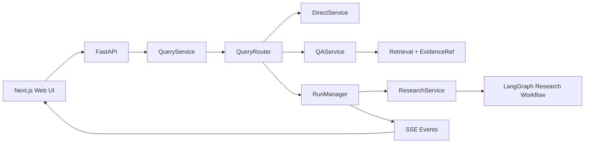

# SAGE Scholar

SAGE Scholar 是基于 SAGE Research 重构的单进程科研 Agent 应用。支持 Direct、文档 QA、异步 Deep Research，独立 Citation Audit 已移除，并统一上下文预算、自动长期 Memory 和可恢复 Run。统一查询接口先经过 Router，再按任务复杂度选择执行链。FastAPI 只处理协议，业务编排集中在 `QueryService`，长任务生命周期由 `RunManager` 管理，研究 Graph 只维护 workflow 内部状态。



## Deep Research 报告链重构（2026-10-09）

当前流程：研究契约 → 任务规划 → Researcher → 缺口审查/定向补查 → 跨论文综合 → 章节规划 → Markdown 写作 → 章节审查/局部修订 → 报告。

- 删除独立 Citation Audit API、自动路由和前端按钮，以及逐 Claim 的 CitationVerifier、ReportDraft、CitationRenderer。保留真实 Evidence、SourcePolicy、原文位置与确定性引用检查。历史 Audit 标签只用于读取旧记录，不能再新建或恢复。
- 规划提供研究维度和完成标准；研究笔记区分一手来源、二手综述和推论。缺口审查按有界批次执行，普通局限不再自动触发反复调研。
- 综合按约 6000 token 的材料组处理并层级归并；Writer 按共享 Outline 分章节写作，每章立即审查，只修有问题的章节。全 Run 最多一次报告阶段定向补读，仍受工具、token 和修订上限限制。
- 每个综合批次、章节写作、审查和局部修订都有 checkpoint。预算不足保留已完成章节并标记阶段性报告；没有可发布正文则明确失败，禁止拼接笔记或工具原文兜底。仅缺写作的续跑复用已完成章节。
- 同一来源版本的多个证据片段合并为一个参考文献编号；citation_evidence 保留编号到全部引用片段的映射。公式和代码中的数组下标不会被当成引用改写。
- Run 持久化阶段输入/输出 token、供应商提供的缓存命中与未命中、耗时及工具失败次数，前端可展开查看。没有缓存字段时显示未知；失败请求若没有 usage，无法统计精确计费。
- 默认预算为 60 万总 token、15 万收尾预留、100 次工具调用、每子题 6 步、最多 8 个任务、1 轮自动补查、每章 1 次修订。单次上下文仍由原 Context Manager 控制。
- 新 checkpoint schema 为 research-markdown-v1。旧版本未完成的 Research 需要明确重新开始；历史已完成报告保留。新版继续使用原 Cancel、HITL、SSE 与恢复机制。
- 已添加 OPD、两论文比较、领域综述的固定合成 Evidence 回归。这些测试验证阶段调用、格式和来源契约，不代表真实模型已达到研究质量要求。本轮未运行付费端到端调研；最后收尾修改按用户要求未重新运行测试。

## Long-term Memory Final Fix（2026-10-08）

- 人工保护仅针对匹配的 consolidation target / tombstone 及人工废弃的历史版本；同一 workspace 中无关记忆被编辑或删除，不再抑制新候选。提交锁内继续核对 revision、目标版本和状态；并发冲突由原持久任务重试并重新规划，不沿用旧合并结果。
- Direct / QA 与 Research 的抽取源包含最近最多 6 条、合计 24,000 字符的完整历史消息；只取连续尾部，不截断原句。历史消息只作上下文，当前用户决定才可新入库。Direct / QA 在入队时保存该快照，Research 从原持久 Run 读取。
- 用户明确接受、拒绝或修改先前方案时，生成可独立理解的 canonical memory。先核对确认原话与上下文的完整原句锚点，再通过现有 Model Gateway 独立核验支持关系、长期意图和最终决定；未确认的助手建议、含糊确认和超出原话的结论不保存。无改写的直接记忆仍保留原句。
- 来源保存确认原话、被确认的完整消息、消息 ID（有则保存）、抽取快照索引和原 history 索引、决策类型与核验理由。记忆面板可展开查看原话和方案上下文。字段为兼容性追加，旧 prepared job 的操作回执保持有效。
- 删除旧 `MemoryStore.recall()`；正式入口统一为 `MemoryService.recall()`，原 task-aware semantic + lexical 排序、revision 缓存和 Context token budget 保持不变。Memory 仍不充当科研 Evidence。
- 正确性边界：语义支持与同义去重仍依赖模型判断；原消息超出近期窗口或确认对象不明时宁可不保存，需要用户明确重述。模型/磁盘故障沿用原任务重试与失败状态，不伪造确认。

## Long-term Memory Finalization（2026-10-07）

- Direct / QA 成功后先将 MemoryExtractionJob 写入现有 runtime.sqlite3，再后台调用模型；Deep Research completed/partial 后同样入队。启动恢复 pending/running/retryable，并补查已完成但未入队的 Research。无需用户确认。
- Memory Policy 仅接受有原句依据的稳定偏好、项目决策、长期背景和研究线索；低置信度、临时要求、助手猜测、无原文依据的结果跳过。保存完整原句，避免模型改写产生额外事实。临时请求继续由 Context/Run state 管理；显式 CRUD 仍可保存 session 笔记。
- new 新增；ignore 不改原记录；update 明确替代旧版并保留 superseded 历史；merge 原样保留双方有效内容与来源，超过记录长度则保留两条 active，不做有损改写。用户手工编辑受保护；deleted tombstone 和过期写入检查防止自动覆盖/复活。
- Recall 结合原问题、当前任务 objective、契约维度和调用用途。按 workspace/session、查询、持久化 revision 缓存至多 256 组 ID/version，重复调用不重复 query embedding；记忆变更自然失效。仍最多注入 5 条相关有效记忆。
- 自动与手动重新抽取共用持久化 Research 输入读取器：优先原 checkpoint 中的 Contract/Notes，缺失时从 SQLite Run/事件重建；包含 final claims、gaps/conflicts/unknowns。研究出处保存 run_id、research_note_id/task_id、claim_id（如有）、quote 和通过原文检查的 evidence_ids。Memory 不是 Evidence。
- 面板支持查看、修改、删除、版本、完整来源及后台任务状态。已删除 confirmed 字段、approve/reject/candidates API 和候选持久审批流程。旧 memory.json 首次写入升级 schema 3，原文件备份为 memory.pre-finalization.json。
- 沿用 [GauzMem](https://github.com/fightheyyy/gauzmem) 的可追溯抽取、consolidation、语义召回与时间生命周期思路；不引入新依赖、分布式服务或第二套 Context/Recovery。
- Job 使用稳定 source key；抽取草稿先持久化，Memory 与操作回执原子写入并 fsync。崩溃后可重试模型调用，但不会因重复提交复活或重复创建已处理记忆；不承诺外部模型调用 exactly-once。失败最多自动尝试 3 次，之后保留 failed，用户可重新整理。
- `/api/memories/extract` 返回 HTTP 202 和 job；GET `/api/memories/jobs` 或 `/jobs/{id}` 查看状态。手动重新抽取也复用原 source/job，不新增第二套写入流程。
- 边界：磁盘不可写时对话仍返回并记录持久化错误，该次对话抽取无法保证恢复；Research 可由持久化完成记录补入队。语义去重/冲突分类仍依赖模型判断。该模块架构到此冻结，仅修明确 bug。

## V4.2：统一 Context 与 QA 连续追问（2026-10-02）

- Context 采用当前指令/SourcePolicy/明确限制 + 最近两轮原始对话 + 较早历史结构化摘要 + Memory + 任务笔记/证据；不再把全部历史 user message 复制进 system。当前指令优先于旧限制与 Memory。
- 旧历史按 token 分块，用同一个 LLMClient 增量汇总目标、先前结论、未解决问题和指代；摘要不作为科研事实。`data/context_summaries` 原子保存摘要，原对话保存在 `data/context_artifacts`，同一 Run 恢复时按内容指纹复用，不展开旧历史到 prompt。压缩失败明确降级为不完整原话摘录，不能假装完成语义摘要。
- 模型调用前统一计入消息/工具 schema、SourcePolicy、Memory、ResearchNote/Evidence、框架开销及输出预留；日志包含分项估算。超限按工具外置、去重、整轮旧工具记录归档、历史摘要、旧过程摘录、证据窗口缩小依次处理，仍放不下明确报错，不静默删除限制。
- 大工具结果保留 artifact/evidence ID、短摘录及定位；`read_context_artifact(identity, offset, limit)` 定向回读。Synthesis/Writer 按主题选择证据，Report Review 按章节检查重要结论。原文窗口截断明确标记，不能假定未展示部分支持结论。
- QA 用共享 conversation context 解析“第二个相比第一个”等追问：先改写检索问题，再把同一历史背景与新检索证据交给回答模型。指代不明确则澄清，不凭历史助手回答生成科研引用。
- 保留原 Research Graph、Run/Checkpoint 与 Memory/Evidence contract；压缩调用也通过原预算账本记账。无新服务或依赖。近期轮数可在 ContextManager 构造参数 `recent_turns` 调整。
- 验证：新增 18 项专项回归，全量后端 208 项通过；compileall、前端 lint/build、diff 检查通过。详细修改文件与边界见本地 [V4.2 交付说明](docs/v4.2-context.md)。
- 边界：token 数是现有 tokenizer 加开销的估算，不是所有 provider 的精确计费；明确限制采用保守指令句提取，复杂隐含要求仍应明确写入当前请求/契约。未给摘要引入事实正确性评分。

## 持久运行与来源边界

- Evidence 保存真实原文、来源身份、版本和位置；搜索摘要、Memory、模型笔记和工具错误不是 Evidence。
- SQLite 保存 Run、SSE 事件、预算、工具结果及 ResearchNote；LangGraph SQLite saver 保存图状态，事件先落库再发送。
- 有兼容 checkpoint 且无未知外部执行状态时恢复原 Run，否则明确要求重新开始。页面刷新只读取和重放，不重复执行研究。

## V2.1 修补（2026-09-26）

- 文档身份与内容版本分离：稳定来源或显式 document_id 更新原 Document，版本成功后切换 active_version。
- 摄取锁与目录锁分开，GET /api/library 能观察 parsing/indexing；新版 failed 时旧 active version 仍可检索。
- 同内容及解析器版本不变时不增加版本；历史 Evidence 继续绑定旧版。上传新版需传 document_id，不按文件名猜测合并。
- 59 项后端测试、compileall、前端 lint/build 通过。行为、API 示例及已知边界见 [V2.1 修补说明](docs/v2.1-document-version-patch.md)。

## 上轮更新（2026-09-25）

- ExecutionRequest 将 Router 的资料范围、文档 ID 和联网限制传到 QA/Research；工具层强制执行。
- 文档使用持久 UUID、内容版本和摄取状态；Evidence 保存原文、版本、位置并支持 API 回读。
- QA 区分定点检索和全文章节概览，内部使用 evidence ID，检测无效引用编号。
- Research 保留原图，新增 PARTIAL 结果与缺口展示；原 HTTP URL 保持不变。
- 最终验证：43 项后端测试、compileall、前端 lint/build 全部通过。真实外部模型/MCP 连通性未在本轮测试。
- 完整交付及边界见 [本轮交付说明](docs/iteration-source-policy.md)。文档按 .gitignore 保留在本地。

## 当前可以运行的功能

- `Direct`：日期、星期等本地确定性问题不调用模型；其他简单问题通过统一 Model Gateway 回答。
- 连续对话：回答后保留输入框和本轮消息，本轮历史交给统一 Context Manager，保留近期对话并汇总较早历史，单独保护明确限制；点击“新对话”可清空本轮上下文。
- `QA`：从上传的论文/文档进行 BM25 + 向量检索、RRF、rerank，并以结构化 `EvidenceRef` 返回证据。
- `Deep Research`：复用 SAGE Research 的 LangGraph 与并行 ReAct，现为 contract → task DAG → ResearchNote → gap review → synthesis → outline → Markdown sections → report review，由后台 `Run` 执行并通过 SSE 推送进度。
- 研究报告只作为 Run 产物返回，不会自动写回 RAG；仅在用户主动点击保存时进入文档库。
- 文档库：上传、导入、列表、删除、保存研究报告。
- 长任务：创建、查询、取消、持久化 SSE 回放、兼容 checkpoint 恢复、显式重新开始；状态保存在本地 SQLite。
- 自适应路由：`今天是星期几` 走 Direct，`帮我调研 AI4CFD 领域的主要方法` 走 Deep Research；指代论文但未选择文档时返回澄清提示。

Router 已为 `Search` 和 `Paper2Code` 建立稳定枚举与返回协议，但这两条执行链尚未接入，调用时会明确返回 `not_implemented`，不会伪造结果。

## 目录

```text
sage-scholar/
├── sage_scholar/
│   ├── api/              # HTTP、schema、SSE
│   ├── application/      # Query/Direct/QA/Research/Document services
│   ├── routing/          # workflow 与 source policy 判断
│   ├── runtime/          # SQLite Run/事件/预算、工具 journal、LangGraph checkpoint
│   ├── domain/           # Evidence 等共享领域模型
│   ├── infrastructure/   # 依赖组装与旧实现 adapter
│   ├── research/         # Deep Research runtime
│   ├── graph/            # LangGraph workflow
│   ├── rag/              # hybrid retrieval
│   ├── memory/           # 自动长期记忆、召回与用户管理
│   ├── context/          # 完整请求预算、保护信息、artifact 外置与回读
│   ├── tools/            # 统一工具基础接口与 registry
│   ├── library/          # 文档转换和文档库
│   ├── mcp/              # MCP client/adapter
│   └── agents/           # research agents 与 prompts
├── web/                   # Next.js 前端
├── tests/                 # Router、QueryService、API 测试
├── configs/               # Agent/MCP 配置
├── data/                  # 本地文档和索引
└── docs/                  # 审计与迁移记录
```

## 环境要求

- Python `3.11–3.14`，推荐 `3.12`
- Node.js `24.21.0`；仓库提供 `.nvmrc`，与你当前终端版本一致
- npm

macOS 推荐使用 CPU/MPS 版 PyTorch，不要安装 CUDA wheel：

```bash
cd /Users/pan/Desktop/1/sage-scholar
conda create -n sage-scholar python=3.12 -y
conda activate sage-scholar
python -m pip install -r requirements.txt

nvm install
nvm use
npm_config_cache="$PWD/.npm-cache" npm --prefix web install

cp .env.example .env
```

`.env` 按实际使用的能力填写：

- 普通 Direct 和 Deep Research 需要所选 LLM provider 的 key。
- 文档 QA/入库默认使用本地 Embedding，无需向量 API Key；首次使用需下载模型。
- Tavily、GitHub 和其他 MCP 服务都是可选项；未配置的服务会被跳过。
- `/api/health`、日期/星期 Direct 和 Router 测试不需要任何 key。

## 启动

分别启动后端和前端：

```bash
cd /Users/pan/Desktop/1/sage-scholar
conda activate sage-scholar
python server.py
```

```bash
cd /Users/pan/Desktop/1/sage-scholar
nvm use
npm --prefix web run dev
```

访问 `http://localhost:3000`，后端默认地址为 `http://localhost:8000`。也可以在完成 `.env` 配置后运行 `./setup.sh` 同时启动两端；按 `Ctrl+C` 会通过脚本 trap 结束两个进程。

统一查询接口示例：

```bash
curl -X POST http://localhost:8000/api/queries \
  -H 'Content-Type: application/json' \
  -d '{"query":"今天是星期几","timezone":"Asia/Shanghai"}'
```

## 验证

```bash
cd /Users/pan/Desktop/1/sage-scholar
python -m pytest -q
python -m compileall -q sage_scholar tests
npm --prefix web test
npm --prefix web run lint
npm --prefix web run build
```

## 已知边界

- Run/事件/预算已持久化；兼容 checkpoint 可恢复原任务。缺失、不兼容或有未知工具调用时明确 interrupted/restart_required，需用户重新开始。
- Deep Research 已接入 ResearchNote/Synthesis/Evidence、Context Manager 和持久化 checkpoint。引用支持核验依赖模型判断，仍需真实样本检验；尚无完整审计 lineage。
- PDF 证据目前可以带来源、版本和可选 section/page 字段，但旧解析链不能稳定提供逐页定位。
- Search、Paper2Code、完整 EvalRunner 和代码沙箱不属于本轮范围。
- 本阶段没有引入 Redis、Celery、Kafka、独立 Worker、认证或多用户并发体系。

工程审计见 [`docs/repository-audit.md`](docs/repository-audit.md)，逐文件迁移来源见 [`docs/migration-map.md`](docs/migration-map.md)。

## V3.2 可用性修补

- Direct、QA 与 Research Report 共享 MarkdownContent（GFM / remark-math / KaTeX）和公式规范化逻辑，保留金额、环境变量与代码中的普通美元符号。
- MCP 在首次需要时按能力加载：公网研究只选 Tavily、fetch、paper-search；PDF 入库只选 pdfmux；arXiv 入库只选 paper-search。Direct、本地 QA 和禁止联网的研究不连接 Web MCP，GitHub 不随研究启动。
- `.env` 的 `MCP_CONNECT_TIMEOUT=12` 设置每个服务的启动、握手及工具列表总期限（秒）。可选服务并行连接，失败后清理会有额外的有限等待，其他服务继续可用。缺少必需 key 时直接跳过。
- SSE 提供工具初始化、可用/不可用和研究开始事件；前端显示简短提示，不展示 MCP 异常堆栈。研究能否完成仍由证据覆盖情况决定，工具故障本身不强制 PARTIAL；无可用来源或覆盖不足则返回 PARTIAL。
- 工具状态缓存在当前进程；修改 key 或修复服务后需重启后端重新连接。此次没有改动 ResearchNote / Evidence / Gap Review / Writer / Verifier 主链。

本轮逐文件修改与验证范围见 [V3.2 修补记录](docs/v3.2-usability-patch.md)。

## 本地 Embedding

`.env` 设置 `EMBEDDING_PROVIDER=local`、`EMBEDDING_LOCAL_MODEL=intfloat/multilingual-e5-small`，不调用 GLM Embedding，也不需要 API Key。复用已有 sentence-transformers/torch 依赖。默认 CPU 和 batch size 16；可通过 EMBEDDING_DEVICE / EMBEDDING_BATCH_SIZE 调整。首次使用会下载模型，已缓存后可设置 EMBEDDING_LOCAL_ONLY=true；也可将模型名替换为本地模型目录。

默认模型支持中英文，使用 query:/passage: 前缀及归一化向量，单段最多 512 tokens。若替换非 E5 模型，需同步按模型说明设置 EMBEDDING_QUERY_PREFIX / EMBEDDING_DOCUMENT_PREFIX。模型或前缀改变后必须重建向量索引；索引保存配置身份，拒绝混用不同模型。来源 PDF 和 Evidence 不因向量配置改变而删除。LLM 对话/研究调用仍使用原来的 provider。

模型说明：https://huggingface.co/intfloat/multilingual-e5-small

### Conversation 与任务交互

- 左侧历史以 Conversation 为单位，普通问答与 Research Run 共用持久化消息。支持搜索、重命名、归档和确认删除；URL `?conversation=...` 支持刷新和前进/后退。
- `/api/conversations` 管理对话；`POST /api/queries` 携带 `conversation_id` 和客户端 `request_id`。服务端读取真实历史，同一请求重试不会重复执行。一个对话同时执行一个任务，不同对话共用进程内执行槽位。
- `POST /api/runs/{id}/cancel` 真正停止调度。MCP 取消指定调用；同步模型请求合作式取消，可能需要等当前网络调用超时，但不会继续派发后续调用。SSE 断开不取消 Run。
- LangGraph 原生 interrupt 保存问题；Run 进入 `waiting_for_user`。`POST /api/runs/{id}/respond` 校验 conversation/run/interrupt ID，再使用 `Command(resume)` 继续。问题及回答持久化，重复或过期回答拒绝。
- Deep Research 默认每个研究员 6 步，Run 最多 100 次工具调用、60 万模型 token、3600 秒活动执行时间；与单次 Context 窗口独立。可通过 `SAGE_DEEP_RESEARCH_MAX_TOOL_CALLS`、`SAGE_DEEP_RESEARCH_MAX_TOTAL_TOKENS`、`SAGE_DEEP_RESEARCH_MAX_SECONDS` 等配置，有硬上限。
- partial 的“继续研究”沿用 run ID、证据、已完成笔记和累计消耗，并在硬上限内追加执行预算。没有兼容 checkpoint 或存在未确认外部调用时，要求明确重新开始，不承诺 exactly-once。
- 删除先留下对话 tombstone，再取消并等待关联 Run 收尾，删除消息、Run journal、事件和 checkpoint，取消未完成的记忆抽取。文献、Evidence 与已经保存的长期记忆属于科研工作区，保留并可单独管理。

### Fetch / Tavily 代理检查

当前 `configs/mcp_servers.json` 为 Fetch、Tavily 显式配置 HTTP 代理
`http://127.0.0.1:7897`，同时设置大小写代理变量，避免父进程中旧变量优先匹配。
Fetch 另使用官方 `--proxy-url` 参数。两者清空遗留 `ALL_PROXY/all_proxy`，本机地址不走代理；保留 TLS 验证和 robots.txt 检查。
此配置需要本机代理软件监听 7897。换端口或停用代理时应同步修改这两个服务的配置。

在项目根目录、已激活 Python 环境的终端中执行：

```bash
python -m sage_scholar.mcp.check --server fetch
python -m sage_scholar.mcp.check --server tavily
```

每个命令均使用项目的 MCP loader，先检查代理端口，再初始化对应服务并实际调用工具。
看到 `[PASS] fetch` 和 `[PASS] tavily_search` 才表示调用成功，只有“初始化成功”不足以证明外网可达。
检查不调用大模型；Tavily 检查会消耗一次搜索 API 调用，需要 `.env` 中有效的 `TAVILY_API_KEY`。
如果仍报 robots/TLS 连接错误，需要检查代理节点到 arXiv/Tavily 的连接；401/403 等错误需另行区分密钥、权限或访问限制。
修改配置后必须停止并重新启动后端，已有 MCP 子进程不会自动更新代理。

### 研究 token 与输入缓存

- 提示词前缀保留稳定的指令、资料权限和预算配置；实时消耗不再注入 prompt，动态缺口和召回 Memory 放在后部。原有压缩、工具配对、来源回读与 Memory/Evidence 边界保持不变。
- 同一研究员重复的成功工具调用复用结果；连续失败或重复无进展时结束该子任务。每个子题最多一次自动补查，每轮最多四个补查任务；没有新增证据/覆盖维度时停止重复研究，未解决项仍进入报告。
- 默认从 60 万 Run token 中预留 15 万用于笔记、综合、报告和审查，可设置 `SAGE_DEEP_RESEARCH_REPORT_RESERVE_TOKENS=150000`（最多占总预算一半）。这是收集阶段的停止边界，不能保证所有规模的报告都能完成；硬上限仍生效。
- Run 卡片显示服务商实际返回的输入缓存命中率；未上报的调用不计入分母。日志中的 `input_cache=unreported` 表示未知，不能当作零命中。缓存输入仍计入累计 token，缓存主要降低输入费用/延迟，实际命中率取决于服务商与请求前缀。
- 重启后新建一次调研，观察累计 token、输入缓存和剩余缺口。旧 Run 的历史消耗不会清零；旧调用没有缓存指标，无法补算。
