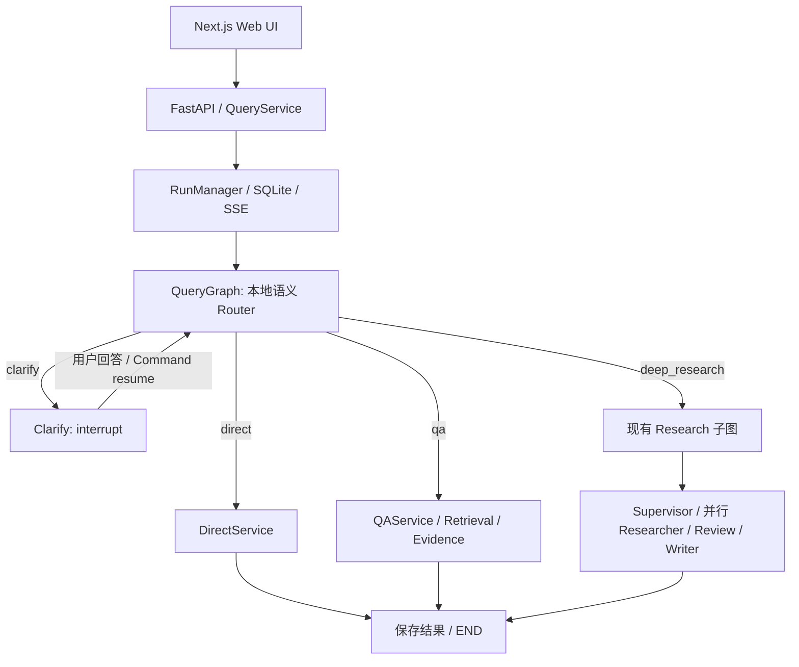

# SAGE Scholar

## PDF 图片 RAG

在原文本 RAG 上增加独立的视觉索引：PDF → Docling 图表区域识别 / PyMuPDF 页面渲染 → 本地 Qwen3-VL-Embedding-2B → 图文两路检索 → RRF 排名融合 → DeepSeek 按需读原图。原有文本 embedding、BM25 和 reranker 不换模型、不清库；不同模型的向量不混算相似度。

上传 PDF 的文字解析仍复用现有 pdfmux MCP；视觉部分在文字入库后补充构建，并未替换这项依赖。当前不支持绕过失败的文字解析、直接把纯图扫描 PDF 当成上传成功。

### 启用

在原来的 Python 环境运行：

```bash
cd /Users/pan/Desktop/1/sage-scholar
conda activate deep-research
python -m pip install -r requirements-visual.txt
hf download Qwen/Qwen3-VL-Embedding-2B
```

将 `.env.example` 的 PDF / VISION 配置段补到自己的 `.env`，不要覆盖已有密钥。默认 `VISUAL_EMBEDDING_LOCAL_ONLY=true`：需要先下载权重，不会在提问时自动下载大模型。视觉 embedding 默认 CPU、每批一张；可在本机确认兼容性后设置 `VISUAL_EMBEDDING_DEVICE=mps`。它与 Router 的 Ollama 模型无关，也不是文本 embedding 模型。

`PDF_VISUAL_PARSER=docling` 使用 Docling 的布局模型，首次运行可能下载它自己的模型。会保留每页渲染图，并额外裁剪识别出的 figure/table，包含图注、页码和坐标；矢量图也通过页面渲染保留。Docling 未安装时明确降级到整页视觉检索。`PDF_VISUAL_PARSER=page` 可以主动使用整页方式，不提供区域识别或 OCR。旋转/坐标无法可靠对应的页面只保留整页，不猜测裁剪位置。

视觉生成默认 `VISION_MODEL_ID=deepseek-flash`，复用 `DEEPSEEK_BASE_URL` 和 `DEEPSEEK_API_KEY`。自定义网关必须实际支持该模型的 `image_url` 输入；模型名称需按网关配置，并核对 `LLM_CONTEXT_WINDOW`。视觉 embedding 本地计算不产生 API 费用，**DeepSeek 读图仍按 API 用量收费**。本功能未改变 Direct、Router 的模型。

重启服务后，新上传 PDF 会建立图片索引；旧 PDF 不会自动重跑，可在文献库点击“重建图片索引”，或者：

```bash
python -m sage_scholar.visual --all
# 只重建某一篇：
python -m sage_scholar.visual --document doc_xxx
```

重建只更新视觉索引，不重算文本向量。命令没有调用付费视觉生成 API。若未保留旧 PDF 原文件，需要重新上传。首次索引速度取决于页数和硬件；长文献建议使用上述 CLI，避免浏览器代理超时。图片依赖/权重缺失时，文本上传和检索仍可使用，文献库显示图片未就绪及原因。

### 检索、读图和来源

- 文本问题继续通过原检索链获取文本；同时用同一个视觉 embedding 模型编码当前问题、检索 PDF 页面/图表，按排名融合。图号/页码只辅助定位，不替代语义检索。
- QA 最多读取 `VISION_MAX_IMAGES=3` 张相关原图；概览仍读取原有文字章节，额外检索相关图片，不声称检查全部图表。
- Research 的 `rag_search` 返回图像 Evidence 来源，`read_pdf_visual` 按问题读取其真实像素。返回值明确标为模型解读，不冒充逐字原文。沿用已有工具 journal、取消、预算与 Evidence 权限检查。
- 图片按 PDF 版本保存到转换目录的 `visual/`，索引记录模型/revision、解析器、PDF hash、图像 hash、页码和 bbox。换模型/revision须重建；旧图片文件保留供历史 Evidence 回读。删除文献后禁止继续从图片接口读取该文献。
- QA 的 Evidence 展开区可看原图，Research 参考文献附原图链接。`GET /api/evidence/{id}/image` 只解析已登记的来源，不接受客户端文件路径。
- Base64 只在最终模型请求处生成，不进入 Conversation、Memory 或 Context history；文本 Context Manager 处理图像来源清单和文字内容。原图是 Evidence；视觉解读是观察，不自动写入原文或长期记忆。

### 图片预算与边界

`VISION_TOKENS_PER_IMAGE=1024` 是保守配置估算，`VISION_RUN_IMAGE_TOKENS=60000` 是独立的累计图片预算。读图次数和估算消耗持久化到现有 SQLite，恢复不会清零；失败/未知执行状态也按尝试保守扣减。文本输入和视觉回答输出继续受原 Run 预算约束。

提供商通常报告混合 prompt 总量，不能据此精确拆出图片费用：累计 token 仍展示提供商原值；文字预算只减去受本地文字估算约束的图片估算部分，图片卡片明确标为估算。文字 + 图片估算 + 输出预留仍须满足模型总上下文上限。估算不等于账单，需根据所用网关校准；这不能绕开提供商的真实上下文限制。

此实现是单向量本地视觉检索，没有新增多模态 reranker；召回/小字识别质量取决于模型、页面分辨率与图表复杂度。没有承诺精确读取所有表格数字。用“解释这篇论文图 2 的曲线与实验结论”“比较表 1 的各方法结果”做真实验收，并核对返回的原图和页码。

实现依据：[Qwen 对齐图文 embedding](https://huggingface.co/Qwen/Qwen3-VL-Embedding-2B)、[Docling 文档结构与位置](https://docling-project.github.io/docling/reference/docling_document/)、[DeepSeek 图像输入](https://api-docs.deepseek.com/guides/vision/)、[Azure 多模态检索](https://learn.microsoft.com/en-us/azure/search/multimodal-search-overview)。

---

SAGE Scholar 是基于 SAGE Research 重构的单进程科研 Agent 应用。所有新查询先创建持久 Run，再进入统一 LangGraph；本机轻量模型负责语义分类，条件边进入 Direct、文档 QA、Clarify 或现有 Deep Research 子图。RunManager 管理生命周期、预算和 SSE，LangGraph 管理 workflow 状态。



## 本地语义 Router 与统一入口图（2026-10-12）

- 默认通过本机 Ollama 的 `/api/chat` 使用 `qwen3.5:2b`，结构化输出 workflow、资料范围、文档 ID、联网需求、置信度和澄清问题。分类参考本轮问题、最近 6 条有限长度的对话、所选文档和最多 50 条文献目录；不会发送完整论文、Memory provenance 或研究工具输出。
- 不再用关键词/正则决定 Direct、QA、Research。未勾选文档时由模型结合目录解析论文指代，文件名出现在句子里不会自动成为强制资料范围；仅保留明确“记住：…”命令的操作识别。服务端仍校验文档身份和 SourcePolicy，模型不能扩大显式文档范围或绕过 `allow_web=false`。
- 分类服务只允许 loopback 地址，绕开环境代理。连接失败、超时或无效 JSON 会明确显示失败，可在修复部署后继续原任务；不会静默回退到云端或关键词。低置信度/缺少必要输入进入持久化 Clarify，最多 3 次澄清。
- `/api/queries` 对 Direct/QA 也返回 `202 accepted + run_id`；前端统一通过 Run/SSE 显示结果和停止按钮。等待用户期间保留同一 Run，刷新或重启后仍可回答。切换页面不取消任务。
- 原 Research 内部算法保持不变。外层图 checkpoint 使用 `run_id` / `semantic-query-v1`，Research 子图私有状态使用 `run_id:research` / 原图结构；预算、工具记录、Evidence、研究笔记仍归属于同一个 Run。继续研究不会重新分类，也不会重新执行已完成的子题。删除 Run 会删除两份图 checkpoint。
- 已持久化的旧 Research Run 继续按原图恢复；旧 Direct/QA 没有 checkpoint 的中断任务需重新开始，不能伪造恢复。Context Manager、Memory 和 Evidence 继续由原服务复用。
- 本地分类 token 和耗时单独记入 `router` 阶段，并计入累计 Run 预算；不产生云端分类费用。回答、研究和后台 Memory 的模型配置不变。

### 部署并检查 Router

先安装并启动 [Ollama](https://ollama.com/download)。本机已运行 Ollama 应用时不用重复执行 `ollama serve`；命令行方式可在另一个终端执行：

```bash
ollama serve
```

下载模型后进行真实分类检查（模型下载仅首次需要）：

```bash
ollama pull qwen3.5:2b
cd /Users/pan/Desktop/1/sage-scholar
conda activate deep-research
python -m sage_scholar.routing.check --query '不要调研，只解释一下 KL 散度'
python -m sage_scholar.routing.check --query '帮我调研 On-Policy Distillation 的主要方法'
```

期望分别返回 `direct` 和 `deep_research`。默认配置已可使用，也可以在 `.env` 设置：

```dotenv
ROUTER_BASE_URL=http://127.0.0.1:11434
ROUTER_MODEL=qwen3.5:2b
ROUTER_TIMEOUT=60
ROUTER_CONFIDENCE_THRESHOLD=0.65
```

预热后按原方式 `./setup.sh` 启动项目。脚本不自动安装 Ollama 或下载模型；模型加载较慢时可调高超时。模型必须支持 Ollama 结构化输出，置信度仍是模型自评，需要用自己的问题检查实际分类质量。

参考：[Ollama Chat API](https://docs.ollama.com/api/chat)、[Qwen3.5 2B](https://ollama.com/library/qwen3.5:2b)、[LangGraph 私有状态子图调用](https://docs.langchain.com/oss/python/langgraph/use-subgraphs)。

## Deep Research 主链简化（2026-10-10）

当前流程：用户目标 → Supervisor 动态拆题 → 并行 Researcher → Supervisor Review / 少量定向补查 → Writer 一次生成完整 Markdown 报告。

- `ExecutionRequest` 是目标、显式约束、SourcePolicy、预算和持久身份的唯一来源；`prompt_brief()` 仅生成轻量提示视图，不创建第二个 Contract，也不按关键词生成研究维度。
- Supervisor 动态生成通常 3–4 个独立子问题；没有任务 DAG、依赖调度或下游失效传播。Review 合并原 Gap Review，只对影响核心回答且可以补查的缺口追加子问题，保留已完成笔记；普通不确定性留在报告中披露。
- Researcher 的 ReAct 直接输出自然语言 Markdown 笔记；达到循环上限时做一次收尾总结，不再调用模型转成 Finding/NoteDraft JSON。笔记只有 `task_id/question/content/source_ids/status`，包括发现、方法/公式、来源与不确定项；原文留在 EvidenceStore 并可回读。
- 删除 Research Synthesis、Outline Agent、Report Reviewer 和逐章节写作。Writer 直接读全部笔记，使用统一来源编号整篇写作；系统只校验引用身份并生成参考文献，不机械审判科研结论。没有正文时不拼接原文充当报告。
- RunManager、SQLite、LangGraph checkpoint、HITL、取消、SSE、Context Manager 和 Memory 继续复用。笔记先落库再进入图的 checkpoint；恢复同一 Run 可复用已完成笔记与工具结果，显式继续只处理未完成问题和新补查。
- 新 checkpoint schema 为 `research-supervisor-markdown-v2`。旧图的未完成 Run 需要重新开始，不能跨图结构续跑；历史报告、Evidence 和 Memory 不删除。新版 Run 仍可正常恢复。
- Memory 从持久 Markdown 笔记抽取研究线索，保留 Run/Task、原句和有效 source IDs；不将研究线索升级为用户决策或 Citation Evidence。
- 默认预算：60 万累计模型 token、15 万收尾预留、100 次工具调用、每子题最多 8 步、全 Run 最多 8 个子题、1 轮自动补查。单次上下文继续由 Context Manager 计量。相关环境变量沿用 `SAGE_DEEP_RESEARCH_*`。
- 本轮只做语法、类型和少量无 API 冒烟验证，不代表真实模型的研究质量已验证。

## Long-term Memory Final Fix（2026-10-08）

- 人工保护仅针对匹配的 consolidation target / tombstone 及人工废弃的历史版本；同一 workspace 中无关记忆被编辑或删除，不再抑制新候选。提交锁内继续核对 revision、目标版本和状态；并发冲突由原持久任务重试并重新规划，不沿用旧合并结果。
- Direct / QA 与 Research 的抽取源包含最近最多 6 条、合计 24,000 字符的完整历史消息；只取连续尾部，不截断原句。历史消息只作上下文，当前用户决定才可新入库。Direct / QA 在入队时保存该快照，Research 从原持久 Run 读取。
- 用户明确接受、拒绝或修改先前方案时，生成可独立理解的 canonical memory。先核对确认原话与上下文的完整原句锚点，再通过现有 Model Gateway 独立核验支持关系、长期意图和最终决定；未确认的助手建议、含糊确认和超出原话的结论不保存。无改写的直接记忆仍保留原句。
- 来源保存确认原话、被确认的完整消息、消息 ID（有则保存）、抽取快照索引和原 history 索引、决策类型与核验理由。记忆面板可展开查看原话和方案上下文。字段为兼容性追加，旧 prepared job 的操作回执保持有效。
- 删除旧 `MemoryStore.recall()`；正式入口统一为 `MemoryService.recall()`，原 task-aware semantic + lexical 排序、revision 缓存和 Context token budget 保持不变。Memory 仍不充当科研 Evidence。
- 正确性边界：语义支持与同义去重仍依赖模型判断；原消息超出近期窗口或确认对象不明时宁可不保存，需要用户明确重述。模型/磁盘故障沿用原任务重试与失败状态，不伪造确认。

## Long-term Memory Finalization（2026-10-07）

- Direct / QA 成功后先将 MemoryExtractionJob 写入现有 runtime.sqlite3，再后台调用模型；Deep Research completed/partial 后同样入队。启动恢复 pending/running/retryable，并补查已完成但未入队的 Research。无需用户确认。
- Memory Policy 仅接受有原句依据的稳定偏好、项目决策、长期背景和研究线索；低置信度、临时要求、助手猜测、无原文依据的结果跳过。保存完整原句，避免模型改写产生额外事实。临时请求继续由 Context/Run state 管理；显式 CRUD 仍可保存 session 笔记。
- new 新增；ignore 不改原记录；update 明确替代旧版并保留 superseded 历史；merge 原样保留双方有效内容与来源，超过记录长度则保留两条 active，不做有损改写。用户手工编辑受保护；deleted tombstone 和过期写入检查防止自动覆盖/复活。
- Recall 结合原问题、当前子问题、研究目标和调用用途。按 workspace/session、查询、持久化 revision 缓存至多 256 组 ID/version，重复调用不重复 query embedding；记忆变更自然失效。仍最多注入 5 条相关有效记忆。
- 自动与手动重新抽取共用持久化 Research 输入读取器：优先原 checkpoint 中的 ExecutionRequest/Markdown Notes，缺失时从 SQLite Run/事件重建；保留笔记限定和主管标注的未覆盖项。研究出处保存 run_id、research_note_id/task_id、claim_id（如有）、quote 和通过原文检查的 evidence_ids。Memory 不是 Evidence。
- 面板支持查看、修改、删除、版本、完整来源及后台任务状态。已删除 confirmed 字段、approve/reject/candidates API 和候选持久审批流程。旧 memory.json 首次写入升级 schema 3，原文件备份为 memory.pre-finalization.json。
- 沿用 [GauzMem](https://github.com/fightheyyy/gauzmem) 的可追溯抽取、consolidation、语义召回与时间生命周期思路；不引入新依赖、分布式服务或第二套 Context/Recovery。
- Job 使用稳定 source key；抽取草稿先持久化，Memory 与操作回执原子写入并 fsync。崩溃后可重试模型调用，但不会因重复提交复活或重复创建已处理记忆；不承诺外部模型调用 exactly-once。失败最多自动尝试 3 次，之后保留 failed，用户可重新整理。
- `/api/memories/extract` 返回 HTTP 202 和 job；GET `/api/memories/jobs` 或 `/jobs/{id}` 查看状态。手动重新抽取也复用原 source/job，不新增第二套写入流程。
- 边界：磁盘不可写时对话仍返回并记录持久化错误，该次对话抽取无法保证恢复；Research 可由持久化完成记录补入队。语义去重/冲突分类仍依赖模型判断。该模块架构到此冻结，仅修明确 bug。

## V4.2：统一 Context 与 QA 连续追问（2026-10-02）

- Context 采用当前指令/SourcePolicy/明确限制 + 优先最近六轮完整问答（按 token 预算动态收缩） + 较早历史结构化摘要 + Memory + 任务笔记/证据；不再把全部历史 user message 复制进 system。当前指令优先于旧限制与 Memory。
- 旧历史按 token 分块，用同一个 LLMClient 增量汇总目标、先前结论、未解决问题和指代；摘要不作为科研事实。`data/context_summaries` 原子保存摘要，原对话保存在 `data/context_artifacts`，同一 Run 恢复时按内容指纹复用，不展开旧历史到 prompt。压缩失败明确降级为不完整原话摘录，不能假装完成语义摘要。
- 模型调用前统一计入消息/工具 schema、SourcePolicy、Memory、ResearchNote/Evidence、框架开销及输出预留；日志包含分项估算。超限按工具外置、去重、整轮旧工具记录归档、历史摘要、旧过程摘录、证据窗口缩小依次处理，仍放不下明确报错，不静默删除限制。
- 大工具结果保留 artifact/evidence ID、短摘录及定位；`read_context_artifact(identity, offset, limit)` 定向回读。Researcher 按问题回读证据，Writer 根据笔记汇总来源引用。原文窗口截断明确标记，不能假定未展示部分支持结论。
- QA 用共享 conversation context 解析“第二个相比第一个”等追问：先改写检索问题，再把同一历史背景与新检索证据交给回答模型。指代不明确则澄清，不凭历史助手回答生成科研引用。
- 保留原 Research Graph、Run/Checkpoint 与 Memory/Evidence contract；压缩调用也通过原预算账本记账。无新服务或依赖。近期轮数可在 ContextManager 构造参数 `recent_turns` 调整。
- 验证：新增 18 项专项回归，全量后端 208 项通过；compileall、前端 lint/build、diff 检查通过。详细修改文件与边界见本地 [V4.2 交付说明](docs/v4.2-context.md)。
- 边界：token 数是现有 tokenizer 加开销的估算，不是所有 provider 的精确计费；明确限制采用保守指令句提取，复杂隐含要求仍应明确写入当前请求/契约。未给摘要引入事实正确性评分。

## 持久运行与来源边界

- Evidence 保存真实原文、来源身份、版本和位置；搜索摘要、Memory、模型笔记和工具错误不是 Evidence。
- SQLite 保存 Run、SSE 事件、预算、工具结果及 ResearchNote；LangGraph SQLite saver 保存图状态，事件先落库再发送。
- 有兼容 checkpoint 且无未知外部执行状态时恢复原 Run，否则明确要求重新开始。页面刷新只读取和重放，不重复执行研究。

## V2.1 修补（2026-09-26）

- 文档身份与内容版本分离：稳定来源或显式 document_id 更新原 Document，版本成功后切换 active_version。
- 摄取锁与目录锁分开，GET /api/library 能观察 parsing/indexing；新版 failed 时旧 active version 仍可检索。
- 同内容及解析器版本不变时不增加版本；历史 Evidence 继续绑定旧版。上传新版需传 document_id，不按文件名猜测合并。
- 59 项后端测试、compileall、前端 lint/build 通过。行为、API 示例及已知边界见 [V2.1 修补说明](docs/v2.1-document-version-patch.md)。

## 上轮更新（2026-09-25）

- ExecutionRequest 将 Router 的资料范围、文档 ID 和联网限制传到 QA/Research；工具层强制执行。
- 文档使用持久 UUID、内容版本和摄取状态；Evidence 保存原文、版本、位置并支持 API 回读。
- QA 区分定点检索和全文章节概览，内部使用 evidence ID，检测无效引用编号。
- Research 保留原图，新增 PARTIAL 结果与缺口展示；原 HTTP URL 保持不变。
- 最终验证：43 项后端测试、compileall、前端 lint/build 全部通过。真实外部模型/MCP 连通性未在本轮测试。
- 完整交付及边界见 [本轮交付说明](docs/iteration-source-policy.md)。文档按 .gitignore 保留在本地。

## 当前可以运行的功能

- `Direct`：经过本地语义分类后，日期、星期由本地时钟回答；其他简单问题通过原 Model Gateway 回答。
- 连续对话：回答后保留输入框和本轮消息，本轮历史交给统一 Context Manager，保留近期对话并汇总较早历史，单独保护明确限制；点击“新对话”可清空本轮上下文。
- `QA`：从上传的论文/文档进行 BM25 + 向量检索、RRF、rerank，并以结构化 `EvidenceRef` 返回证据。
- `Deep Research`：复用 SAGE Research 的 LangGraph 与并行 ReAct，现为 ExecutionRequest → Supervisor Plan → 并行 Researcher → Supervisor Review → 整篇 Writer，由后台 `Run` 执行并通过 SSE 推送进度。
- 研究报告只作为 Run 产物返回，不会自动写回 RAG；仅在用户主动点击保存时进入文档库。
- 文档库：上传、导入、列表、删除、保存研究报告。
- 长任务：创建、查询、取消、持久化 SSE 回放、兼容 checkpoint 恢复、显式重新开始；状态保存在本地 SQLite。
- 自适应路由：`今天是星期几` 走 Direct，`帮我调研 AI4CFD 领域的主要方法` 走 Deep Research；指代论文但未选择文档时返回澄清提示。

独立 `Search`、`Citation Audit` 和 `Paper2Code` 尚无入口执行链，显式 API 请求会被拒绝。需要外部资料的查询进入 Deep Research；路由模型识别出未支持的任务时请求澄清，不承诺虚假结果。

## 目录

```text
sage-scholar/
├── sage_scholar/
│   ├── api/              # HTTP、schema、SSE
│   ├── application/      # Query/Direct/QA/Research/Document services
│   ├── routing/          # 本地模型分类 / schema / SourcePolicy 校验 / check 命令
│   ├── runtime/          # SQLite Run/事件/预算、工具 journal、LangGraph checkpoint
│   ├── domain/           # Evidence 等共享领域模型
│   ├── infrastructure/   # 依赖组装与旧实现 adapter
│   ├── research/         # Deep Research runtime
│   ├── graph/            # QueryGraph 统一入口 + Research 子图
│   ├── rag/              # hybrid retrieval
│   ├── memory/           # 自动长期记忆、召回与用户管理
│   ├── context/          # 完整请求预算、保护信息、artifact 外置与回读
│   ├── tools/            # 统一工具基础接口与 registry
│   ├── library/          # 文档转换和文档库
│   ├── mcp/              # MCP client/adapter
│   └── agents/           # research agents 与 prompts
├── web/                   # Next.js 前端
├── tests/                 # Router、QueryService、API 测试
├── configs/               # Agent/MCP 配置
├── data/                  # 本地文档和索引
└── docs/                  # 审计与迁移记录
```

## 环境要求

- Python `3.11–3.14`，推荐 `3.12`
- Node.js `24.21.0`；仓库提供 `.nvmrc`，与你当前终端版本一致
- npm
- Ollama + 本地 `qwen3.5:2b`（Router 使用；其他模型仍走原 provider）

macOS 推荐使用 CPU/MPS 版 PyTorch，不要安装 CUDA wheel：

```bash
cd /Users/pan/Desktop/1/sage-scholar
conda create -n sage-scholar python=3.12 -y
conda activate sage-scholar
python -m pip install -r requirements.txt

nvm install
nvm use
npm_config_cache="$PWD/.npm-cache" npm --prefix web install

cp .env.example .env
```

`.env` 按实际使用的能力填写：

- 普通 Direct 和 Deep Research 需要所选 LLM provider 的 key。
- 文档 QA/入库默认使用本地 Embedding，无需向量 API Key；首次使用需下载模型。
- Tavily、GitHub 和其他 MCP 服务都是可选项；未配置的服务会被跳过。
- `/api/health` 无模型依赖；实际查询需要本地 Router 就绪。日期回答本身无需云端 key，单元测试使用分类器替身，不代表真实模型质量验证。

## 启动

分别启动后端和前端：

```bash
cd /Users/pan/Desktop/1/sage-scholar
conda activate sage-scholar
python server.py
```

```bash
cd /Users/pan/Desktop/1/sage-scholar
nvm use
npm --prefix web run dev
```

访问 `http://localhost:3000`，后端默认地址为 `http://localhost:8000`。也可以在完成 `.env` 配置后运行 `./setup.sh` 同时启动两端；按 `Ctrl+C` 会通过脚本 trap 结束两个进程。

统一查询接口示例：

```bash
curl -X POST http://localhost:8000/api/queries \
  -H 'Content-Type: application/json' \
  -d '{"query":"今天是星期几","timezone":"Asia/Shanghai"}'
```

## 验证

```bash
cd /Users/pan/Desktop/1/sage-scholar
python -m pytest -q
python -m compileall -q sage_scholar tests
npm --prefix web test
npm --prefix web run lint
npm --prefix web run build
```

## 已知边界

- Run/事件/预算已持久化；兼容 checkpoint 可恢复原任务。缺失、不兼容或有未知工具调用时明确 interrupted/restart_required，需用户重新开始。
- Deep Research 已接入 Markdown ResearchNote/Evidence、Context Manager 和持久化 checkpoint。科研结论的支持关系仍依赖研究与写作模型判断；确定性引用检查只保证身份，不等于事实核验。
- PDF 证据目前可以带来源、版本和可选 section/page 字段，但旧解析链不能稳定提供逐页定位。
- Search、Paper2Code、完整 EvalRunner 和代码沙箱不属于本轮范围。
- 本阶段没有引入 Redis、Celery、Kafka、独立 Worker、认证或多用户并发体系。

工程审计见 [`docs/repository-audit.md`](docs/repository-audit.md)，逐文件迁移来源见 [`docs/migration-map.md`](docs/migration-map.md)。

## V3.2 可用性修补

- Direct、QA 与 Research Report 共享 MarkdownContent（GFM / remark-math / KaTeX）和公式规范化逻辑，保留金额、环境变量与代码中的普通美元符号。
- MCP 在首次需要时按能力加载：公网研究只选 Tavily、fetch、paper-search；PDF 入库只选 pdfmux；arXiv 入库只选 paper-search。Direct、本地 QA 和禁止联网的研究不连接 Web MCP，GitHub 不随研究启动。
- `.env` 的 `MCP_CONNECT_TIMEOUT=12` 设置每个服务的启动、握手及工具列表总期限（秒）。可选服务并行连接，失败后清理会有额外的有限等待，其他服务继续可用。缺少必需 key 时直接跳过。
- SSE 提供工具初始化、可用/不可用和研究开始事件；前端显示简短提示，不展示 MCP 异常堆栈。研究能否完成仍由证据覆盖情况决定，工具故障本身不强制 PARTIAL；无可用来源或覆盖不足则返回 PARTIAL。
- 工具状态缓存在当前进程；修改 key 或修复服务后需重启后端重新连接。此次没有改动 ResearchNote / Evidence / Gap Review / Writer / Verifier 主链。

本轮逐文件修改与验证范围见 [V3.2 修补记录](docs/v3.2-usability-patch.md)。

## 本地 Embedding

`.env` 设置 `EMBEDDING_PROVIDER=local`、`EMBEDDING_LOCAL_MODEL=intfloat/multilingual-e5-small`，不调用 GLM Embedding，也不需要 API Key。复用已有 sentence-transformers/torch 依赖。默认 CPU 和 batch size 16；可通过 EMBEDDING_DEVICE / EMBEDDING_BATCH_SIZE 调整。首次使用会下载模型，已缓存后可设置 EMBEDDING_LOCAL_ONLY=true；也可将模型名替换为本地模型目录。

默认模型支持中英文，使用 query:/passage: 前缀及归一化向量，单段最多 512 tokens。若替换非 E5 模型，需同步按模型说明设置 EMBEDDING_QUERY_PREFIX / EMBEDDING_DOCUMENT_PREFIX。模型或前缀改变后必须重建向量索引；索引保存配置身份，拒绝混用不同模型。来源 PDF 和 Evidence 不因向量配置改变而删除。LLM 对话/研究调用仍使用原来的 provider。

模型说明：https://huggingface.co/intfloat/multilingual-e5-small

### Conversation 与任务交互

- 左侧历史以 Conversation 为单位，普通问答与 Research Run 共用持久化消息。支持搜索、重命名、归档和确认删除；URL `?conversation=...` 支持刷新和前进/后退。
- `/api/conversations` 管理对话；`POST /api/queries` 携带 `conversation_id` 和客户端 `request_id`。服务端读取真实历史，同一请求重试不会重复执行。一个对话同时执行一个任务，不同对话共用进程内执行槽位。
- `POST /api/runs/{id}/cancel` 真正停止调度。MCP 取消指定调用；同步模型请求合作式取消，可能需要等当前网络调用超时，但不会继续派发后续调用。SSE 断开不取消 Run。
- LangGraph 原生 interrupt 保存问题；Run 进入 `waiting_for_user`。`POST /api/runs/{id}/respond` 校验 conversation/run/interrupt ID，再使用 `Command(resume)` 继续。问题及回答持久化，重复或过期回答拒绝。
- Deep Research 默认每个研究员最多 8 步，Run 最多 100 次工具调用、60 万模型 token、3600 秒活动执行时间；与单次 Context 窗口独立。可通过 `SAGE_DEEP_RESEARCH_MAX_TOOL_CALLS`、`SAGE_DEEP_RESEARCH_MAX_TOTAL_TOKENS`、`SAGE_DEEP_RESEARCH_MAX_SECONDS` 等配置，有硬上限。
- partial 的“继续研究”沿用 run ID、证据、已完成笔记和累计消耗，并在硬上限内追加执行预算。没有兼容 checkpoint 或存在未确认外部调用时，要求明确重新开始，不承诺 exactly-once。
- 删除先留下对话 tombstone，再取消并等待关联 Run 收尾，删除消息、Run journal、事件和 checkpoint，取消未完成的记忆抽取。文献、Evidence 与已经保存的长期记忆属于科研工作区，保留并可单独管理。

### Fetch / Tavily 代理检查

当前 `configs/mcp_servers.json` 为 Fetch、Tavily 显式配置 HTTP 代理
`http://127.0.0.1:7897`，同时设置大小写代理变量，避免父进程中旧变量优先匹配。
Fetch 另使用官方 `--proxy-url` 参数。两者清空遗留 `ALL_PROXY/all_proxy`，本机地址不走代理；保留 TLS 验证和 robots.txt 检查。
此配置需要本机代理软件监听 7897。换端口或停用代理时应同步修改这两个服务的配置。

在项目根目录、已激活 Python 环境的终端中执行：

```bash
python -m sage_scholar.mcp.check --server fetch
python -m sage_scholar.mcp.check --server tavily
```

每个命令均使用项目的 MCP loader，先检查代理端口，再初始化对应服务并实际调用工具。
看到 `[PASS] fetch` 和 `[PASS] tavily_search` 才表示调用成功，只有“初始化成功”不足以证明外网可达。
检查不调用大模型；Tavily 检查会消耗一次搜索 API 调用，需要 `.env` 中有效的 `TAVILY_API_KEY`。
如果仍报 robots/TLS 连接错误，需要检查代理节点到 arXiv/Tavily 的连接；401/403 等错误需另行区分密钥、权限或访问限制。
修改配置后必须停止并重新启动后端，已有 MCP 子进程不会自动更新代理。

### 研究 token 与输入缓存

- 提示词前缀保留稳定的指令、资料权限和预算配置；实时消耗不再注入 prompt，动态缺口和召回 Memory 放在后部。原有压缩、工具配对、来源回读与 Memory/Evidence 边界保持不变。
- 同一研究员重复的成功工具调用复用结果；连续失败或重复无进展时结束该子任务。每个子题最多一次自动补查，每轮最多四个补查任务；没有新增证据/覆盖维度时停止重复研究，未解决项仍进入报告。
- 默认从 60 万 Run token 中预留 15 万用于笔记、Supervisor Review 和报告，可设置 `SAGE_DEEP_RESEARCH_REPORT_RESERVE_TOKENS=150000`（最多占总预算一半）。这是收集阶段的停止边界，不能保证所有规模的报告都能完成；硬上限仍生效。
- Run 卡片显示服务商实际返回的输入缓存命中率；未上报的调用不计入分母。日志中的 `input_cache=unreported` 表示未知，不能当作零命中。缓存输入仍计入累计 token，缓存主要降低输入费用/延迟，实际命中率取决于服务商与请求前缀。
- 重启后新建一次调研，观察累计 token、输入缓存和剩余缺口。旧 Run 的历史消耗不会清零；旧调用没有缓存指标，无法补算。


## Agent 上下文与 ReAct 恢复（2026-10-15）

研究主链保持 `Supervisor → 并行 Researcher → Supervisor Review → 整篇 Writer`。

- 新 Run 的 Researcher 最多 8 次 ReAct 模型调用，可提前产出笔记；工具调用总数、时间、全 Run 60 万 token 和 15 万收尾预留不变。已有 Run 恢复继续遵守其持久化预算，不偷偷重置消费或扩大限制。
- Researcher 单次输出 4096 token，收尾笔记 4096；仅在模型明确返回 `finish_reason=length` 时允许一次 6144 的扩展笔记尝试。仍截断则标为不完整。Writer 整篇报告上限 16384，篇幅由问题决定；截断不会当作完整报告。
- `_history → _build_messages → LLMClient.invoke → ContextManager.prepare → provider`：provider 收到的是 `prepare.messages`，不是原始历史。完整计量包括指令、工具 schema、历史、Memory、研究材料和输出预留。单次预算与累计 Run 消耗分开。
- Supervisor 使用相关历史摘要；Researcher 使用自己的子问题和私有 ReAct；Review/Writer 使用全部笔记及任务/来源材料，不重复注入 Conversation 全文。明确用户限制和 SourcePolicy 在各调用中保留。Memory 按任务召回精简视图；Review 不额外注入 Memory。
- 普通连续问答优先保留最近 6 轮完整问答（当前问题不计入历史），按剩余预算逐轮缩小窗口。超过 2000 token 的历史长回答用摘要和 artifact 引用代替。摘要在同一 workspace/conversation 内缓存复用；原始 Conversation 记录不变。
- SQLite 现有 results 表增加 `react:{task_id}:{revision}` 记录，由 run_id 隔离。每次已完成的模型响应、每个工具结果分别提交；保存私有消息、来源 ID、步数和必要计数，不保存完整组装后的 prompt。大工具原文外置为 artifact，Evidence 原文仍由 EvidenceStore 管理。
- LangGraph 继续负责工作流 checkpoint；恢复原节点时读取 ReAct 记录，补全未完成的工具批次，复用 Tool Journal 已提交结果，再继续模型步骤。模型响应在响应后取消检查前提交。模型异常保留原任务 revision；已完成其他 ResearchNote 不重跑。`deepcopy` 只压缩发送副本，不改变用于恢复的规范消息记录。
- 不承诺 exactly-once：进程若在远端返回、但本地提交前被杀，仍可能重复该次模型调用；工具未知状态沿用现有安全重试/人工处理规则。旧 Run 在本次升级前未保存的 ReAct 步骤无法补建。大规模笔记仍可能触及单次预算，不能用更高输出限额保证无限深度。

配置见 `.env.example`。Agent 工作窗口分别默认 20000/30000/48000/64000（Supervisor/Researcher/Review/Writer，包含输出预留），不表示必须花满。未知或自定义代理模型使用长输出前需核对服务商并配置 `LLM_MAX_OUTPUT_TOKENS` 和 `LLM_CONTEXT_WINDOW`；超限会在请求前拒绝。当前 DeepSeek 官方模型上限参考 [模型价格与能力](https://api-docs.deepseek.com/quick_start/pricing/) 和 [Chat API](https://api-docs.deepseek.com/api/create-chat-completion/)，自定义网关可能更低。

## Supervisor 最小充分拆分（2026-10-15）

- 默认先考虑一个 Researcher 是否足够，通常 1–4 个互补子问题；复杂任务可更多，仍受 Run 总任务数约束。没有固定关键词数量规则、补足任务数量的循环或额外去重 Agent。
- Supervisor 在原有一次规划内识别用户目标 `requirements`，为每题输出自包含 `objective`、预期产出 `expected_output`、规范化研究范围 `scope_keys` 和覆盖目标 `covers`。语义等价的成果使用相同范围标识；不能仅按论文相同认定任务重复。
- 代码合并同范围/完全相同的问题，保留各目标、产出和范围标识；合并后校验所有声明目标仍被覆盖。任务名额不足时合并溢出项，不直接截掉用户要求。字段不能无损容纳的异常方案会拒绝，不伪造覆盖成功。
- Review 优先判断全部笔记是否已能回答问题。新增补查须说明具体 `research_gap`、新研究目标与预期成果；仅仅要求更详细不会自动派任务。已完成/部分完成/待执行的相同范围会过滤，包含新增目标的部分交叉仍保留；被过滤任务声明的真实缺口不会被假装解决，而是留给 Writer 披露。
- 显式“继续研究”不再把 remaining_gaps 字符串直接变成任务，没有已审定补充任务时先进入 Supervisor Review。原有轮次、总任务量、工具及 token 预算、Send 并行派发和 ResearchNote 汇总保持不变。
- 新字段随 ResearchTask checkpoint 持久化；旧 checkpoint 缺少字段时使用空默认值。语义判断仍由同一次 Supervisor 调用负责，代码核验标识与覆盖关系，不声称字符串算法能够独立证明语义等价；测试使用固定模型输出，不替代真实模型效果验收。
